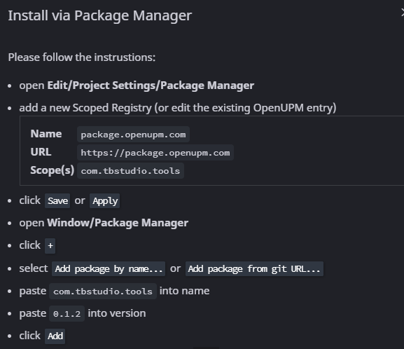

# TB Studio Tools

[](https://unity.com/)
[](LICENSE)

A tool with editor tools and ready to use modular systems.

> 📖 **Looking for full guides and details? Check out the [Official GitHub Wiki](https://github.com/TBStudio-TB/TBStudio.Unity-Tools/wiki).**

---

## ✨ Key Features

- **Editor Task List:** Keep track of task in the unity editor.
- **Performance-First:** Designed with low overhead and zero GC allocations in hot loops.

---

## ⚡ Quick Start

### Installation

#### Option 1: Unity Package Manager via OpenUPM (Recommended)



#### Option 2: Unity Package Manager via Git URL

1. Open your project in Unity.
2. Go to **Window** > **Package Manager**.
3. Click the **`+`** icon in the top left corner and select **Add package from git URL...**
4. Paste the repository URL:
   ```text
   https://github.com/TBStudio-TB/TBStudio.Unity-Tools.git
   ```
